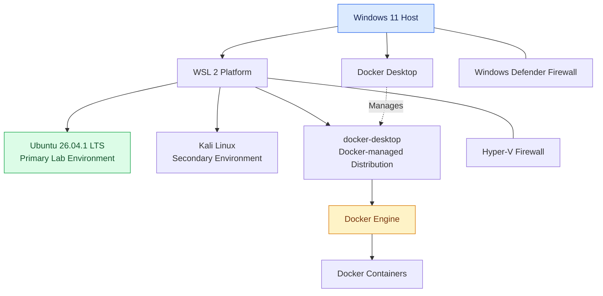
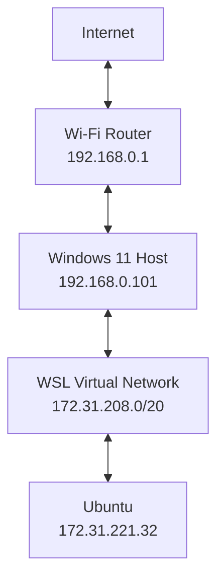
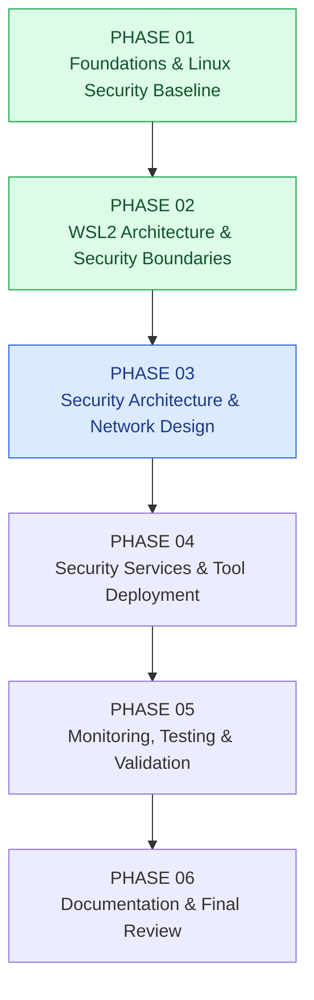
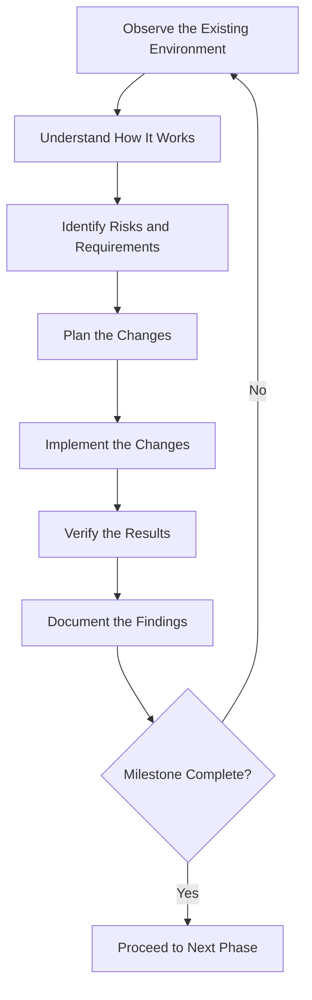

# Homelab Cybersecurity Lab

A hands-on cybersecurity homelab designed to explore Linux administration, network security, system hardening, containerisation, security monitoring and practical security testing.

The project is developed incrementally. Each phase focuses on understanding, designing, implementing and validating a specific part of the environment.

---

# 1. Technology Stack

## Current Technology Stack

| Category | Technology |
|---|---|
| Host Operating System | Windows 11 |
| Linux Environment | WSL2 |
| Primary Linux Distribution | Ubuntu 26.04.1 LTS |
| Secondary Linux Distribution | Kali Linux |
| Container Platform | Docker Desktop |
| Container Engine | Docker Engine |
| Container Orchestration | Docker Compose |
| Scripting | Bash, PowerShell |
| Version Control | Git |
| Repository Hosting | GitHub |

## Hardware Specifications

| Component | Specification |
|---|---|
| Processor | Intel Core i7-1355U |
| RAM | 16 GB |
| Graphics | Integrated Graphics |
| Host Machine | Windows 11 Laptop |

**Note:** The technologies listed above are part of the existing environment. Additional cybersecurity tools and services will be selected and introduced in later phases after evaluating their purpose, resource requirements and security implications.

---

# 2. Project Overview

## What is this project?

This project involves building a practical cybersecurity lab using an existing Windows and Linux environment.

The goal is to understand how systems communicate, how security boundaries are established, how services are deployed and how security configurations can be monitored and tested.

Instead of installing several security tools immediately, the project follows a structured implementation process.

## Key Objectives

- Understand Linux system administration and security.
- Explore network architecture, DNS, ports and firewall policies.
- Understand the security boundaries between Windows and Linux.
- Learn Docker and container security.
- Design and implement security services.
- Explore monitoring, logging and vulnerability assessment.
- Perform controlled security testing and troubleshooting.
- Maintain technical documentation throughout implementation.

---

# 3. System Architecture

The current lab runs on a Windows 11 host using WSL2 for Linux environments and Docker Desktop for container management.

## Current Environment Architecture



### Component Responsibilities

| Component | Responsibility |
|---|---|
| Windows 11 | Primary host operating system |
| WSL2 | Provides the Linux execution environment |
| Ubuntu | Primary environment for lab development and administration |
| Kali Linux | Secondary Linux distribution for security-related learning |
| Docker Desktop | Manages Docker functionality on Windows |
| Docker Engine | Runs and manages containers |
| Windows Defender Firewall | Controls Windows host network traffic |
| Hyper-V Firewall | Applies network filtering to supported WSL virtual machines |

**Architecture note:** WSL2 distributions share the underlying Windows host environment. They should not be considered equivalent to completely isolated physical machines.

---

# 4. Network Architecture

The initial assessment identified a virtual network between the Windows host and Ubuntu.

## Observed Network Configuration

| Component | IP Address |
|---|---|
| Windows Wi-Fi Interface | `192.168.0.101` |
| Wi-Fi Default Gateway | `192.168.0.1` |
| Windows WSL Virtual Adapter | `172.31.208.1` |
| Ubuntu Network Interface | `172.31.221.32/20` |
| Ubuntu Default Gateway | `172.31.208.1` |
| Ubuntu DNS Endpoint | `10.255.255.254` |

## Observed Network Flow



### Connectivity Tests Completed

| Test | Result |
|---|---|
| DNS resolution from Ubuntu | Successful |
| Outbound HTTPS connection to GitHub | Successful |
| Windows-to-Ubuntu connectivity through WSL IP | Successful |

The exact WSL networking mode and all possible LAN-to-WSL access paths have not yet been exhaustively verified.

---

# 5. Implementation Phases

The project is divided into six phases. Each phase builds on the findings and decisions of the previous phase.



## Phase 01 — Foundations & Linux Security Baseline

<sub>Status: COMPLETED</sub>

**Objective:** Understand the existing Ubuntu environment and establish its initial security baseline before making configuration changes.

### Activities

- Identify the current Linux user and administrative privileges.
- Examine user groups and sudo permissions.
- Inspect network interfaces and routing tables.
- Identify listening ports and running services.
- Review enabled system services.
- Examine the availability of Linux security controls.
- Check package updates and system maintenance status.
- Record the initial security observations.

### Key Findings

- Ubuntu 26.04.1 LTS is running on WSL2.
- The primary user has administrative sudo privileges.
- The user belongs to the Docker group.
- DNS and time-related listeners were observed.
- UFW is not installed.
- AppArmor is not enforcing profiles in the current WSL environment.
- Available package updates were applied, with four phased updates remaining.

### Documentation

`docs/implementation/phase_1_foundations_and_server_hardening/`

| File | Description |
|---|---|
| `01-security-baseline.md` | Initial Linux security assessment, command explanations, observations and interview preparation |

---

## Phase 02 — WSL2 Architecture & Security Boundaries

<sub>Status: COMPLETED — INVESTIGATION AND DOCUMENTATION</sub>

**Objective:** Understand how Windows, WSL2, Ubuntu and Docker interact, and identify the network security boundaries between them.

### Activities

- Examine WSL2 architecture and installed distributions.
- Inspect WSL virtual network interfaces and IP addresses.
- Understand the relationship between Windows and Ubuntu networking.
- Examine DNS configuration and resolution.
- Test outbound Internet connectivity.
- Inspect Windows Defender Firewall policies.
- Inspect Hyper-V Firewall settings and rules.
- Investigate inbound rules for TCP ports 3306 and 33060.
- Test Windows-to-Ubuntu connectivity.
- Identify security limitations of the current environment.

### Key Findings

- WSL2 uses a virtualised Linux kernel.
- Windows and Ubuntu can communicate through the WSL virtual network.
- Windows Defender Firewall and Hyper-V Firewall are enabled.
- Both firewall configurations have inbound-block defaults.
- Two persistent inbound Hyper-V Firewall rules exist for TCP ports 3306 and 33060.
- No corresponding active listeners were found during the assessment.
- The purpose and creator of those two rules remain unconfirmed.

### Documentation

`docs/architecture/`

| File | Description |
|---|---|
| `02-wsl2-security-boundaries.md` | WSL2 architecture, network configuration, firewall investigation, connectivity tests and security observations |

---

## Phase 03 — Security Architecture & Network Design

<sub>Status: UP NEXT</sub>

**Objective:** Design the security architecture before deploying additional tools or services.

### Planned Activities

- Define the overall lab architecture.
- Design network topology and isolation boundaries.
- Decide where each service should run: Windows, Ubuntu or Docker.
- Define container networking and communication requirements.
- Establish firewall and port-exposure policies.
- Evaluate resource requirements against available hardware.
- Select suitable security tools.
- Identify potential risks and dependencies.
- Document architectural decisions before implementation.

### Expected Deliverables

`docs/architecture/`

| Planned File | Description |
|---|---|
| `03-security-architecture.md` | Overall security architecture and design decisions |
| `04-network-design.md` | Network topology, communication paths and isolation strategy |
| `05-service-placement.md` | Decisions about where individual services will run |

*These are planned filenames. Files will be created as the corresponding work is completed.*

---

## Phase 04 — Security Services & Tool Deployment

<sub>Status: PLANNED</sub>

**Objective:** Implement the security services selected during Phase 03.

### Planned Activities

- Prepare the required deployment environment.
- Configure Docker Compose services where appropriate.
- Deploy selected security tools incrementally.
- Configure service networking and access permissions.
- Manage configuration files and environment variables.
- Validate that each service starts and operates correctly.
- Document installation and configuration decisions.

### Expected Deliverables

| Planned File | Description |
|---|---|
| `docker/docker-compose.yml` | Container deployment definitions |
| `configs/` | Service configuration files |
| `scripts/` | Supporting automation and maintenance scripts |
| `docs/implementation/phase_4/04-service-deployment.md` | Deployment procedures and configuration explanations |

*The final tool selection and filenames will depend on Phase 03 architecture decisions.*

---

## Phase 05 — Monitoring, Testing & Validation

<sub>Status: PLANNED</sub>

**Objective:** Validate the deployed environment and understand how security events, service behaviour and configuration failures can be investigated.

### Planned Activities

- Inspect service logs.
- Monitor system and container behaviour.
- Test firewall and network restrictions.
- Validate service availability.
- Perform controlled security tests.
- Investigate configuration failures.
- Record findings and corrective actions.

### Expected Deliverables

| Planned File | Description |
|---|---|
| `docs/testing/05-test-plan.md` | Test scenarios and expected results |
| `docs/testing/05-validation-results.md` | Actual test outcomes and observations |
| `docs/troubleshooting/05-troubleshooting.md` | Errors, investigations and resolutions |

---

## Phase 06 — Documentation & Final Review

<sub>Status: PLANNED</sub>

**Objective:** Consolidate the implementation, test evidence and technical understanding into a complete project record.

### Planned Activities

- Review the final architecture.
- Verify deployment and configuration documentation.
- Consolidate test results.
- Document known limitations and unresolved issues.
- Review security decisions and improvements.
- Update the README to reflect the final implementation.
- Prepare a technical walkthrough and interview explanations.

### Expected Deliverables

| Planned File | Description |
|---|---|
| `docs/final-architecture.md` | Final architecture and system overview |
| `docs/final-implementation-report.md` | Consolidated implementation report |
| `docs/testing/final-validation-report.md` | Final testing and validation summary |

---

# 6. Repository Structure

The repository separates architecture documentation, implementation records, configuration, testing and automation.

```text
homelab/
│
├── configs/
│
├── docker/
│
├── docs/
│   ├── architecture/
│   │   └── 02-wsl2-security-boundaries.md
│   │
│   ├── implementation/
│   │   └── phase_1_foundations_and_server_hardening/
│   │       └── 01-security-baseline.md
│   │
│   ├── testing/
│   │
│   └── troubleshooting/
│
├── scripts/
│
├── .gitignore
└── README.md
```

The structure will expand as additional phases introduce new files and services.

---

# 7. Development Methodology

Every phase follows a consistent implementation workflow.



### Core Principles

- Understand before modifying.
- Prefer evidence over assumptions.
- Make one logical change at a time.
- Verify every configuration change.
- Keep credentials and secrets out of version control.
- Document both successful and unsuccessful tests.
- Distinguish between implemented, tested and planned features.

---

# 8. Learning Outcomes

By completing this project, the intended learning outcomes include:

- Linux system administration and hardening.
- Network architecture, routing, DNS and firewall management.
- Windows and Linux security boundaries.
- Docker and container security.
- Security service deployment and configuration.
- System monitoring and log analysis.
- Vulnerability assessment and controlled testing.
- Technical troubleshooting.
- Security documentation and architectural decision-making.

---

## Current Project Status

**Completed:** Phase 01 and Phase 02.

**Next milestone:** Phase 03 — Security Architecture & Network Design.

This project is actively being developed. The README and supporting documentation will be updated as each phase is implemented and verified.
