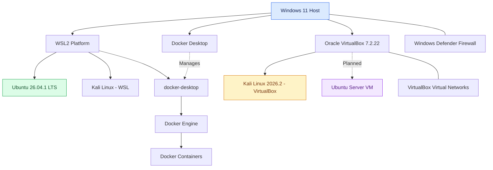
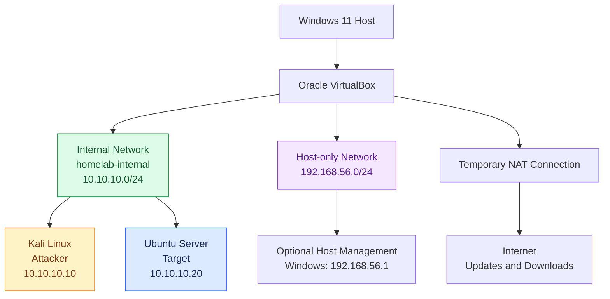
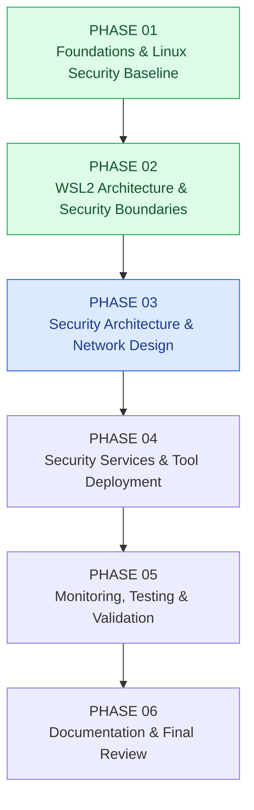
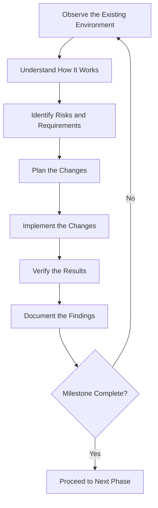

# Homelab Cybersecurity Lab

A hands-on cybersecurity homelab designed to explore Linux administration, network security, system hardening, virtualisation, containerisation, security monitoring and practical security testing.

The project is developed incrementally. Each phase focuses on understanding, designing, implementing and validating a specific part of the environment.

The lab uses an existing Windows 11 laptop with WSL2, Docker Desktop and Oracle VirtualBox. The architecture is designed to support controlled security testing without exposing vulnerable lab machines to the home network or the internet.

---

# 1. Technology Stack

## Current Environment

| Category | Technology |
|---|---|
| Host Operating System | Windows 11 |
| Linux Environment | WSL2 |
| Primary WSL Distribution | Ubuntu 26.04.1 LTS |
| Secondary WSL Distribution | Kali Linux |
| Virtualisation Platform | Oracle VirtualBox 7.2.22 |
| Existing Virtual Machine | Kali Linux 2026.2 |
| Container Platform | Docker Desktop |
| Container Engine | Docker Engine |
| Container Orchestration | Docker Compose |
| Scripting | Bash, PowerShell |
| Version Control | Git |
| Repository Hosting | GitHub |

## Hardware Specifications

| Component | Specification |
|---|---|
| Processor | Intel Core i7-1355U |
| RAM | 16 GB |
| Graphics | Integrated Graphics |
| Host Machine | Windows 11 Laptop |
| Available Disk Space | Approximately 70 GB at last assessment |

**Note:** The technologies listed above are part of the existing environment. Not every technology will necessarily be used in the final lab architecture. Additional tools and services will be selected based on their purpose, resource requirements and security implications.

---

# 2. Project Overview

## What is this project?

This project involves building a practical cybersecurity lab using virtual machines and an existing Windows and Linux environment.

The goal is to understand:

- How computers and services communicate over networks.
- How network segmentation and security boundaries work.
- How Linux systems and services are secured.
- How vulnerabilities can be identified and investigated.
- How security events and system logs can be monitored.
- How security configurations can be tested and validated.

Rather than installing several security tools immediately, the project follows a structured process: observe the existing environment, understand its behaviour, design the architecture, implement changes and verify the results.

## Key Objectives

- Understand Linux system administration and security.
- Explore network architecture, DNS, ports, routing and firewall policies.
- Understand the security boundaries between Windows, WSL2 and virtual machines.
- Build an isolated network for controlled security testing.
- Deploy and secure services on Linux machines.
- Explore security monitoring, logging and vulnerability assessment.
- Perform controlled security testing and troubleshooting.
- Maintain technical documentation throughout implementation.

---

# 3. System Architecture

The lab uses Windows 11 as the physical host. Multiple virtualisation and container technologies are available on the host, but they serve different purposes.

## Current Environment Architecture



The diagram distinguishes existing components from the planned Ubuntu Server virtual machine.

## Component Responsibilities

| Component | Responsibility |
|---|---|
| Windows 11 | Physical host operating system |
| WSL2 | Provides Linux environments within Windows |
| Ubuntu WSL2 | Primary environment for Linux administration and project development |
| Kali WSL2 | Separate Linux environment for security-related learning |
| VirtualBox | Runs independent virtual machines |
| Kali VirtualBox VM | Dedicated attacker and security testing machine |
| Ubuntu Server VM | Planned target machine for controlled security exercises |
| Docker Desktop | Manages Docker functionality on Windows |
| Docker Engine | Runs and manages containers |
| Windows Defender Firewall | Controls Windows host network traffic |

**Architecture note:** WSL2 distributions share the underlying Windows host environment. VirtualBox virtual machines provide a separate guest operating system environment, but their isolation still depends on correct hypervisor and network configuration.

The Kali installation in WSL2 and the Kali VirtualBox VM are separate environments. The VirtualBox VM will be reused for the main attacker role.

---

# 4. Security Architecture and Network Design

Phase 3 established the intended architecture for the practical cybersecurity lab.

The initial lab will use two VirtualBox machines:

1. Kali Linux — attacker and testing machine.
2. Ubuntu Server — target and workload machine.

A separate monitoring VM will not be deployed initially. Lightweight endpoint monitoring will be used to avoid unnecessary resource consumption.

## 4.1 Planned Network Topology

The lab will use three types of VirtualBox network connections.



This is the planned design, not the current configured network.

## 4.2 Network Roles

| Network | Subnet | Purpose | Status |
|---|---|---|---|
| Internal Network | `10.10.10.0/24` | Communication between Kali and Ubuntu | Planned |
| Host-only Network | `192.168.56.0/24` | Optional Windows-to-VM management | Existing adapter |
| NAT | VirtualBox-managed | Temporary internet access | Existing Kali connection |

### Internal Network

The Internal Network will be named:

`homelab-internal`

Planned IP allocation:

| Machine | Role | IP Address |
|---|---|---|
| Kali Linux | Attacker | `10.10.10.10/24` |
| Ubuntu Server | Target | `10.10.10.20/24` |

Static IP addresses will be used so that the machines retain predictable addresses.

The Internal Network will initially have no default gateway. This allows the two lab machines to communicate locally without introducing an unnecessary route to external networks.

### Host-only Network

An existing VirtualBox Host-only adapter was discovered on the Windows host.

| Property | Existing Value |
|---|---|
| Network | `192.168.56.0/24` |
| Windows Host IP | `192.168.56.1` |
| DHCP Server | `192.168.56.100` |
| DHCP Lease Range | `192.168.56.101–192.168.56.254` |

This network may be used for controlled management access later. No lab VM connection to this network has been confirmed.

### NAT

NAT provides a virtual machine with outbound internet access through the host's network connection.

It will be used temporarily for operating system updates, software installation and downloading required tools.

Unnecessary NAT connections will be disconnected during isolated testing.

## 4.3 Communication and Isolation Policy

The initial design follows these rules:

- Kali can send selected testing traffic to Ubuntu.
- Ubuntu can return the responses required for communication.
- Windows will not have direct access to the Internal Network by default.
- The Ubuntu target will not be directly exposed to the home Wi-Fi network or internet.
- Unnecessary outbound internet access from Ubuntu will be disabled during isolated exercises.
- Bridged networking will not be used for the vulnerable target.

**Important:** The network design has not yet been implemented. These are intended security policies that will be verified during Phase 4.

---

# 5. Implementation Phases

The project is divided into six phases. Each phase builds on the findings and decisions of the previous phase.



## Phase 01 — Foundations & Linux Security Baseline

**Status: COMPLETED**

**Objective:** Understand the existing Ubuntu environment and establish its initial security baseline before making configuration changes.

### Activities

- Identify the current Linux user and administrative privileges.
- Examine user groups and sudo permissions.
- Inspect network interfaces and routing tables.
- Identify listening ports and running services.
- Review enabled system services.
- Examine the availability of Linux security controls.
- Check package updates and system maintenance status.
- Record the initial security observations.

### Key Findings

- Ubuntu 26.04.1 LTS is running on WSL2.
- The primary user has administrative sudo privileges.
- The user belongs to the Docker group.
- DNS and time-related listeners were observed.
- UFW is not installed.
- AppArmor is not enforcing profiles in the current WSL environment.
- Available package updates were applied, with four phased updates remaining.

### Documentation

`docs/implementation/phase_1_foundations_and_server_hardening/`

| File | Description |
|---|---|
| `01-security-baseline.md` | Initial Linux security assessment, command explanations, observations and interview preparation |

---

## Phase 02 — WSL2 Architecture & Security Boundaries

**Status: COMPLETED — INVESTIGATION AND DOCUMENTATION**

**Objective:** Understand how Windows, WSL2, Ubuntu and Docker interact, and identify the network security boundaries between them.

### Activities

- Examine WSL2 architecture and installed distributions.
- Inspect WSL virtual network interfaces and IP addresses.
- Understand the relationship between Windows and Ubuntu networking.
- Examine DNS configuration and resolution.
- Test outbound internet connectivity.
- Inspect Windows Defender Firewall policies.
- Inspect Hyper-V Firewall settings and rules.
- Investigate inbound rules for TCP ports 3306 and 33060.
- Test Windows-to-Ubuntu connectivity.
- Identify security limitations of the current environment.

### Key Findings

- WSL2 uses a virtualised Linux kernel.
- Windows and Ubuntu can communicate through the WSL virtual network.
- Windows Defender Firewall and Hyper-V Firewall are enabled.
- Both firewall configurations have inbound-block defaults.
- Two persistent inbound Hyper-V Firewall rules exist for TCP ports 3306 and 33060.
- No corresponding active listeners were found during the assessment.
- The purpose and creator of those two rules remain unconfirmed.

### Documentation

`docs/architecture/`

| File | Description |
|---|---|
| `02-wsl2-security-boundaries.md` | WSL2 architecture, network configuration, firewall investigation, connectivity tests and security observations |

---

## Phase 03 — Security Architecture & Network Design

**Status: DESIGN WORK IN PROGRESS**

**Objective:** Finalise the lab architecture, network topology and service placement before deploying additional tools or services.

### Architecture Decisions

- Use VirtualBox-based network segmentation.
- Reuse the existing Kali Linux 2026.2 VM.
- Create a new Ubuntu Server VM as the target.
- Use a VirtualBox Internal Network named `homelab-internal`.
- Use static IP addressing.
- Reserve the existing Host-only network for optional management access.
- Use NAT temporarily for updates and downloads.
- Avoid bridged networking for the vulnerable target.
- Begin with lightweight endpoint monitoring rather than a separate SOC VM.
- Introduce vulnerabilities individually under controlled conditions.

### Planned Network Addressing

| Machine | Planned Address |
|---|---|
| Kali Linux | `10.10.10.10/24` |
| Ubuntu Server | `10.10.10.20/24` |
| Internal Network | `10.10.10.0/24` |

These addresses are proposed and have not yet been assigned.

### Documentation

`docs/architecture/`

| File | Description |
|---|---|
| `03-security-architecture.md` | Overall architecture, machine roles, security principles and design decisions |
| `04-network-design.md` | Network topology, IP addressing, communication policies and isolation strategy |
| `05-service-placement.md` | Service placement, monitoring approach and resource allocation |

The architecture design is documented. Network configuration and deployment remain pending.

---

## Phase 04 — Security Services & Tool Deployment

**Status: PLANNED**

**Objective:** Implement the architecture designed during Phase 03.

### Planned Activities

- Select and download the Ubuntu Server image.
- Create and configure the Ubuntu Server VM.
- Allocate appropriate RAM, CPU and storage.
- Configure the VirtualBox Internal Network.
- Assign static IP addresses.
- Establish a secure initial baseline.
- Deploy selected services incrementally.
- Configure authentication and service access.
- Set up endpoint logging and monitoring.
- Validate network isolation and connectivity.

### Expected Deliverables

| File or Folder | Description |
|---|---|
| `configs/` | Service and system configuration files |
| `scripts/` | Supporting automation and maintenance scripts |
| `docker/` | Container deployment definitions, if required |
| `docs/implementation/phase_4/` | Deployment procedures and configuration explanations |

The final tools and deployment files will depend on the implementation requirements.

---

## Phase 05 — Monitoring, Testing & Validation

**Status: PLANNED**

**Objective:** Validate the deployed environment and understand how security events, service behaviour and configuration failures can be investigated.

### Planned Activities

- Inspect system and authentication logs.
- Monitor application and service behaviour.
- Test firewall and network restrictions.
- Validate service availability.
- Perform controlled vulnerability assessments.
- Investigate configuration failures.
- Introduce and detect selected security weaknesses.
- Apply corrective measures and verify the results.

### Expected Deliverables

| Planned File | Description |
|---|---|
| `docs/testing/05-test-plan.md` | Test scenarios and expected results |
| `docs/testing/05-validation-results.md` | Actual test outcomes and observations |
| `docs/troubleshooting/05-troubleshooting.md` | Errors, investigations and resolutions |

---

## Phase 06 — Documentation & Final Review

**Status: PLANNED**

**Objective:** Consolidate the implementation, test evidence and technical understanding into a complete project record.

### Planned Activities

- Review the final architecture.
- Verify deployment and configuration documentation.
- Consolidate test results.
- Document known limitations and unresolved issues.
- Review security decisions and improvements.
- Update the README to reflect the final implementation.
- Prepare a technical walkthrough and interview explanations.

### Expected Deliverables

| Planned File | Description |
|---|---|
| `docs/final-architecture.md` | Final architecture and system overview |
| `docs/final-implementation-report.md` | Consolidated implementation report |
| `docs/testing/final-validation-report.md` | Final testing and validation summary |

---

# 6. Repository Structure

The repository separates architecture documentation, implementation records, configuration, testing and automation.

```text
homelab/
│
├── configs/
│
├── docker/
│
├── docs/
│   ├── architecture/
│   │   ├── 02-wsl2-security-boundaries.md
│   │   ├── 03-security-architecture.md
│   │   ├── 04-network-design.md
│   │   └── 05-service-placement.md
│   │
│   ├── implementation/
│   │   └── phase_1_foundations_and_server_hardening/
│   │       └── 01-security-baseline.md
│   │
│   ├── testing/
│   │
│   └── troubleshooting/
│
├── scripts/
│
├── .gitignore
└── README.md
```

The architecture files describe the design. Their presence does not mean the proposed network or services have already been deployed.

The structure will expand as additional phases introduce new files and services.

---

# 7. Development Methodology

Every phase follows a consistent implementation workflow.



### Core Principles

- Understand before modifying.
- Prefer evidence over assumptions.
- Make one logical change at a time.
- Verify every configuration change.
- Keep credentials and secrets out of version control.
- Document both successful and unsuccessful tests.
- Distinguish between designed, implemented and tested features.
- Avoid unnecessary exposure of vulnerable systems.
- Use snapshots as recovery points before major experiments.

---

# 8. Learning Outcomes

By completing this project, the intended learning outcomes include:

- Linux system administration and hardening.
- Network architecture, routing, DNS and firewall management.
- Windows, WSL2 and virtual machine security boundaries.
- Virtualisation and network segmentation.
- Docker and container security.
- Security service deployment and configuration.
- System monitoring and log analysis.
- Vulnerability assessment and controlled testing.
- Technical troubleshooting.
- Security documentation and architectural decision-making.

---

# Current Project Status

| Phase | Description | Status |
|---|---|---|
| 01 | Foundations & Linux Security Baseline | Completed |
| 02 | WSL2 Architecture & Security Boundaries | Completed |
| 03 | Security Architecture & Network Design | Design in progress |
| 04 | Security Services & Tool Deployment | Planned |
| 05 | Monitoring, Testing & Validation | Planned |
| 06 | Documentation & Final Review | Planned |

**Next milestone:** Complete the Phase 03 supporting documentation and final architecture review.

**Following phase:** Phase 04 — Security Services & Tool Deployment.

This project is actively being developed. Documentation and architecture decisions will be updated as each implementation milestone is completed and verified.
